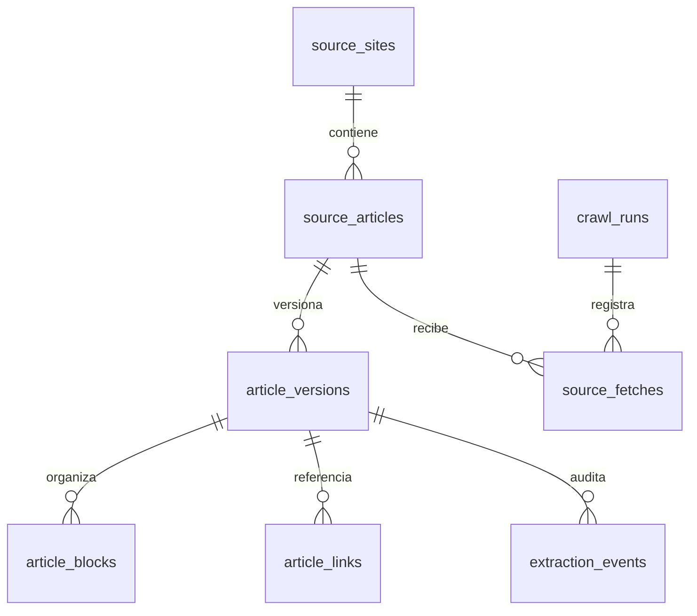

# Extracción y almacenamiento de guías

Decisiones del 3 de noviembre de 2026. Alcance de esta etapa: descubrir artículos, descargar HTML, extraer **solo contenido textual**, limpiar y almacenar. No se llama a Gemini ni se crean borradores en WordPress.

## Evidencia de la muestra

Se leyeron completos 15 artículos y se inspeccionó su HTML. Las observaciones por URL y los selectores están en [muestra A](research_a.md), [muestra B](research_b.md) y [muestra C](research_c.md). Se descargaron las primeras tres páginas del índice: 18 artículos como conjunto inicial de comprobación. El índice vivo cambió respecto a las versiones en caché: el descubrimiento no depende de una lista fija de títulos ni de posiciones.

Hallazgos que afectan directamente a la implementación:

| Elemento | Tratamiento | Motivo |
|---|---|---|
| H2–H6, párrafos, listas y avisos editoriales | Conservar texto, orden y jerarquía | La futura adaptación necesita contexto, no una cadena plana |
| Tablas HTML | Conservar filas, celdas, encabezados y spans | Evita mezclar importes, condiciones y países |
| FAQ Kadence / Rank Math | Conservar pregunta y respuesta juntas | Algunas preguntas están dentro de botones y las respuestas están ocultas por un acordeón |
| Enlace contextual a otra guía | Conservar las palabras del enlace; separar URL | Eliminar la frase completa destruiría contenido útil |
| «Read also», recomendaciones de lectura, índices | Excluir | Dependen de navegación que no existe en los destinos |
| Promociones, formularios, enlaces de afiliados | Excluir o separar frases comerciales | No forman parte del material editorial reutilizable |
| Firmas, revisión por expertos, citas personales | Excluir del contenido para adaptación; auditar | No transferir autoría ni acreditaciones |
| Experiencias propias dentro de prosa, listas o tablas | Cuarentena y revisión cuando se detectan | No transformar una experiencia particular en una afirmación general |
| Cita institucional o advertencia técnica | Conservar con su contexto y referencia | No todas las citas son testimonios del autor |
| Fotografías, vídeo, mapas, calculadoras interactivas | Excluir | Alcance de solo texto; no se descargan medios |
| Ranking/datos que existen solo en una imagen | Registrar dependencia de medio | La extracción textual no puede reconstruir esos datos |
| Cabecera, pie, comentarios, tarjetas de otros artículos | Excluir mediante la raíz editorial | Son contenido ajeno al cuerpo del artículo |

La raíz comprobada es `article.single-entry .entry-content.single-content`. Elegir `.entry-content` sin contexto puede incluir tarjetas de otros artículos. Si la estructura deja de ser reconocible, se registra un error: una página de bloqueo o una portada no se convierte en un artículo vacío.

## Almacenamiento

SQLite es suficiente para esta etapa local y permite migrar después sin acoplar el scraper a Gemini o WordPress. El artículo tiene una identidad estable; cada cambio editorial o de reglas de limpieza puede generar una versión inmutable. Las descargas y los fallos tienen un historial separado.



| Entidad | Información importante |
|---|---|
| Sitio | Dominio y URL de origen |
| Artículo | URL canónica, título, versión actual |
| Versión | Idioma, fechas originales, fecha de captura, versión del limpiador, hashes, texto original y limpio, metadatos de procedencia y advertencias |
| Bloque | Identificador, posición de origen y de salida, tipo, texto, ruta de sección, estructura de listas/tablas/FAQ |
| Enlace | Destino, texto visible, bloque de origen, tipo y decisión de conservación |
| Evento de limpieza | Motivo, texto retirado, posición, selector, vecinos conservados y necesidad de revisión |
| Ejecución / descarga | Configuración, inicio/fin, resultado, URL solicitada, respuesta o error |

El HTML original se conserva como respaldo comprimido local, identificado por hash. Es un documento de procedencia; no se descargan fotos, vídeos ni otros recursos enlazados. Permite repetir la limpieza sin volver a solicitar el artículo. La base guarda texto y estructura, no una copia visual del sitio.

Los autores/revisores del origen se mantienen únicamente como metadatos históricos. No se incluyen como credenciales en la exportación destinada a la futura IA. Fechas de publicación, modificación y extracción son distintas; no se usa la fecha de un comentario como fecha del artículo.

Consultas útiles para inspeccionar la base con cualquier visor SQLite:

```sql
-- Texto de la versión actual de cada artículo; no mezclar versiones históricas.
SELECT a.id, a.canonical_url, v.title, v.clean_text, v.review_required
FROM source_articles AS a
JOIN article_versions AS v ON v.id = a.current_version_id;

-- Bloques en orden de un artículo concreto.
SELECT b.block_key, b.kind, b.text, b.section_path_json, b.data_json
FROM article_blocks AS b
JOIN source_articles AS a ON a.current_version_id = b.version_id
WHERE a.id = 2
ORDER BY b.position;

-- Auditoría editorial: este texto retirado NO va en el export para IA.
SELECT e.reason, e.original_text, e.requires_review,
       e.prev_block_key, e.next_block_key
FROM extraction_events AS e
JOIN source_articles AS a ON a.current_version_id = e.version_id
WHERE a.id = 2
ORDER BY e.source_order, e.id;
```

## Qué ocurre con los espacios que dejan las exclusiones

No se guardan huecos físicos ni párrafos de relleno. El texto de lectura se reconstruye uniendo los bloques conservados con separaciones normales. Se podan encabezados sin contenido. Una foto o un anuncio retirado normalmente no necesita reemplazo.

Un **hueco de significado** sí necesita seguimiento. Por ejemplo: una pregunta cuya única respuesta era un testimonio, un párrafo que anunciaba una cita retirada o un ranking disponible solo en una imagen. Cada omisión queda asociada con su posición y los bloques anterior y posterior; las omisiones informativas generan una advertencia de revisión.

La futura adaptación recibirá esos avisos por separado. Podrá reparar una transición con información ya conservada, omitir una sección o solicitar información adicional. No deberá inventar hechos para alcanzar la longitud del original. En esta etapa no se escribe ninguna transición nueva.

## Contrato para la futura adaptación

La exportación JSON incluye identidad del origen, fechas, idioma, texto limpio, bloques estructurados, referencias externas conservadas, avisos de omisiones y reglas para tratar esos avisos. El texto retirado y el HTML de respaldo permanecen fuera de esa exportación.

El JSON es la entrada recomendada para Gemini u otra API. El texto plano está disponible para lectura, pero pierde estructura y avisos; no conviene usarlo como único contexto de generación.

Todavía no se convierten monedas, países, requisitos, ejemplos o fechas. Los casos de EE. UU., Reino Unido o UE se conservan con su alcance original: la etapa futura deberá decidir su aplicabilidad a Canadá y Colombia. Una exportación limpia no equivale a una verificación jurídica o fiscal. La revisión de estructura encontró diferencias entre afirmaciones, años y alguna respuesta FAQ aparentemente desubicada; el extractor no las corrige silenciosamente.

## Límites del limpiador

Las reglas son deterministas y auditables, pero la separación semántica no es perfecta. Hay referencias indirectas a testimonios o promoción que requieren lectura editorial. Los avisos de revisión indican que el material está almacenado, no aprobado para publicación. Cambiar reglas requiere incrementar la versión del limpiador y reprocesar los respaldos; las versiones anteriores se conservan.

El adaptador implementado corresponde a `movingtospain.com`. Los otros dominios propios podrán añadirse con reglas y muestras de sus respectivas plantillas; ser del mismo propietario no garantiza una estructura HTML idéntica.
