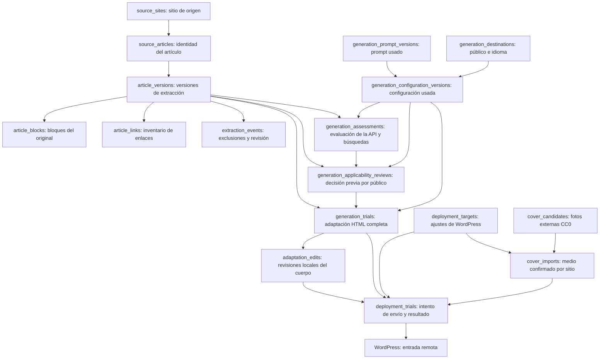

# Estructura de la base de datos

## Ampliación: categorías y consumo (6 de noviembre de 2026)

Estas tablas auxiliares se crean al usar la función correspondiente; las lecturas no crean filas ni llaman a OpenAI.

| Tabla / campo | Contenido y finalidad |
|---|---|
| `wordpress_category_catalogs` | Catálogo real consultado mediante GET a WordPress: ID, nombre, slug, descripción y padre; origen, fecha, revisión y categoría predeterminada si la conexión permite consultarla. |
| `wordpress_category_policies` | Categorías permitidas por destino y `excluded_default_category_id`. Guarda conexión y revisión; no asigna la misma categoría a todos los artículos. |
| `generation_assessments.category_selection_json` | Clasificación elegida por la API durante la evaluación existente: IDs seleccionados, destino, revisiones y copia de las categorías candidatas. El contenido editorial de `decision_json` conserva su contrato anterior. Las evaluaciones antiguas quedan sin clasificación, sin regenerarse. |
| `adaptation_category_overrides` | Selección manual local por adaptación, contexto, revisión y fecha. Prevalece al desplegar, sin modificar el HTML ni WordPress al guardarla. Se elimina al borrar la adaptación. |
| `generation_cost_quotes` | Estimación revisable del lote, hash de la selección y del presupuesto, detalle del cálculo y fecha. Iniciar un nuevo lote requiere una estimación correspondiente y vigente. |

El consumo real continúa en `usage_json` de `generation_assessments` y `generation_trials`, con la respuesta original cuando se conserva. Se consultan `input_tokens`, `input_tokens_details.cached_tokens`, `input_tokens_details.cache_write_tokens`, `output_tokens`, `output_tokens_details.reasoning_tokens` y `total_tokens`. La auditoría incluye intentos borrados para no ocultar gastos y relaciona evaluación/redacción por su `run_key`, no solo por el artículo. Razonamiento y escritura de caché son subconjuntos de salida y entrada: no se suman de nuevo como tokens adicionales.

Las respuestas del panel añaden `usage_summary` por adaptación: evaluación y redacción asociadas por clave, artículo y configuración, seis contadores, costes por etapa y total en USD. Solo exponen contadores numéricos documentados; campos inesperados del proveedor, solicitudes y respuestas completas permanecen privados. Los importes son calculados, no registros de factura. La evaluación ausente en una prueba automática se marca como consumo incompleto.

`last_adapted_at` es un campo calculado para el listado, no una modificación de las versiones de origen. Obtiene la última finalización de una generación completa conservada, excluyendo `adaptation_deletions`. Sirve para ordenar, filtrar por estado y aplicar fechas de Bogotá de forma consistente con la selección masiva.

Al iniciar el servidor se instalan los triggers `panel_require_cost_quote_v1` y `deployment_require_categories_v1` sobre las tablas existentes. Impiden nuevas reservas con el contrato antiguo sin presupuesto o sin categorías permitidas antes de las llamadas externas; no reescriben los registros históricos. La exclusión del panel simultáneo utiliza un bloqueo del sistema operativo en el archivo `.panel.lock`, separado de SQLite.

Las tarifas y el presupuesto acordado son archivos de configuración separados: `config/openai-pricing-2026-11-06.json` y `config/generation-budget.json`. Los costes calculados son estimaciones locales, no importes de factura. Consulte [la auditoría de consumo](auditoria-consumo-2026-11-06.md) y [el uso del panel](panel-local.md).

Inventario inicial comprobado el **5 de noviembre de 2026**, mediante consultas de solo lectura a `data/source_articles.db` y revisión del código. Los conteos de esa inspección se conservan como referencia histórica; no son un recuento automático de la base actual.

Actualización posterior del mismo día: las acciones del panel incorporan dos tablas auxiliares al iniciarse, descritas en la sección 7. Los conteos siguientes corresponden a la inspección anterior a activar esas acciones; el desarrollo y sus pruebas utilizaron bases temporales.

La revisión de aplicabilidad y la búsqueda/importación de portadas añaden `generation_applicability_reviews`, `cover_candidates` y `cover_imports`, documentadas abajo según el código actual. La evaluación automática posterior incorpora `generation_assessments` y permite revisiones `source=model` vinculadas a su respuesta. Su existencia y sus filas dependen de que se hayan inicializado o utilizado esos servicios. Las plantillas y configuraciones iniciales se actualizaron a revisión 4; las revisiones históricas siguen conservadas. Esta actualización documental no vuelve a ejecutar generaciones ni envíos.

Actualización del **6 de noviembre de 2026**: `adaptation_edits` conserva las ediciones locales del cuerpo adaptado y `panel_generation_runs` registra los lotes que el usuario inicia desde el panel. Las adaptaciones eliminadas ya no aparecen en las listas, detalles ni resúmenes públicos. Los CTA se editan desde **Preparación de adaptaciones → Destinos** y siguen almacenados en `deployment_targets.cta_links_json`, sin una segunda copia en las configuraciones editoriales.

## 1. ¿Dónde están las adaptaciones? ¿Se guardan por bloques?

**Sí se almacenan en SQLite. La salida original de la API queda como un cuerpo HTML completo en `generation_trials.html`; cada edición posterior del usuario se guarda en `adaptation_edits.html`. No se divide en filas de bloques como los artículos originales.**

| Contenido | Ubicación principal | Forma de almacenamiento |
|---|---|---|
| Texto original antes de limpiar | `article_versions.original_text` | Texto completo del cuerpo extraído, para auditoría |
| Texto original limpio | `article_versions.clean_text` | Texto completo, construido a partir de los bloques conservados |
| Estructura del original limpio | `article_blocks` | Una fila por bloque y versión: párrafo, encabezado, lista, tabla, FAQ o cita |
| Adaptación devuelta por la IA | `generation_trials.html` | Un fragmento HTML completo por prueba de generación |
| Ediciones locales de la adaptación | `adaptation_edits.html` | Un cuerpo HTML completo por revisión; la última es la versión utilizada por el panel y los siguientes envíos |
| Normalización automática de formato | `generation_html_formats.html` | HTML semántico equivalente, sin cambiar la redacción original; se usa si no hay una edición manual posterior |
| Respuesta del proveedor | `generation_trials.response_json` | JSON de la respuesta recibida; puede contener el mismo texto y datos técnicos |
| Contenido enviado a WordPress | `deployment_trials.payload_json`, propiedad `content` | Copia del cuerpo enviado, junto con título, imagen, categorías y otros campos |

El HTML adaptado tiene encabezados, párrafos y listas, pero esas etiquetas **no equivalen a bloques independientes en la base**: no tienen filas, claves de bloque ni relación individual con los bloques de origen.

Una posible confusión: `generation_trials.snapshot_json` contiene `example.source_context.content.blocks`. Estos son los **bloques del artículo original usado como entrada**, no los bloques de la adaptación resultante. En la prueba colombiana, la plantilla empleó `{{article_text}}`, es decir, el texto limpio completo. Guardar los bloques de origen en el contexto no significa que se enviaran como JSON estructurado al modelo.

## 2. Organización general

La aplicación utiliza una base **SQLite** en `data/source_articles.db`. Comparte el archivo entre cuatro responsabilidades: extracción, panel, generación y despliegue.



El diagrama resume relaciones de contenido; no muestra todas las claves foráneas. Los planes de preparación y los registros de descarga se explican más abajo.

### Cómo leer los campos

- `id` identifica una fila. Un campo como `article_id` identifica su artículo relacionado.
- `version` es el número de revisión dentro de un prompt o configuración; `version_id` es el ID global de una fila de revisión. Por ejemplo, la revisión 3 del prompt colombiano tiene ID 9.
- Los campos terminados en `_json` son columnas `TEXT` que contienen JSON. El esquema comprueba su sintaxis con `json_valid`; el contenido interno depende de cada módulo.
- Los indicadores como `enabled` o `review_required` se guardan como enteros `0` o `1`.
- Las fechas se guardan como texto ISO 8601. Los tiempos generados por la aplicación se escriben en UTC; las fechas editoriales conservan la información obtenida de la fuente y pueden ser `NULL` si se desconocen.
- `published_at`, `modified_at` y `captured_at` son distintos: publicación original, modificación original y captura local. No se sustituye una fecha editorial desconocida por la fecha de extracción.

### Inventario histórico de la inspección inicial

Conteos de la base inspeccionada, no valores fijos del sistema. Los bloques, enlaces y eventos incluyen **todas las versiones históricas**, no solo el artículo vigente.

| Módulo | Tabla | Filas | Qué representa |
|---|---|---:|---|
| Extracción | `source_sites` | 1 | Sitios de origen |
| Extracción | `source_articles` | 107 | Artículos identificados por URL canónica |
| Extracción | `article_versions` | 535 | Versiones de contenido extraído |
| Extracción | `article_blocks` | 52624 | Bloques conservados de esas versiones |
| Extracción | `article_links` | 20725 | Enlaces identificados y su tratamiento |
| Extracción | `extraction_events` | 16176 | Exclusiones y advertencias de limpieza |
| Extracción | `crawl_runs` | 8 | Ejecuciones de extracción y operaciones relacionadas |
| Extracción | `source_fetches` | 536 | Registros de captura o intento |
| Panel | `dashboard_selection` | 1 | Artículos seleccionados en el panel |
| Generación | `generation_schema` | 1 | Marcador de inicialización editorial |
| Generación | `generation_destinations` | 3 | Públicos e idiomas de destino |
| Generación | `generation_prompts` | 3 | Identidades de prompts |
| Generación | `generation_prompt_versions` | 9 | Revisiones de esos prompts |
| Generación | `generation_configurations` | 3 | Identidades de configuraciones |
| Generación | `generation_configuration_versions` | 9 | Revisiones de esas configuraciones |
| Generación | `generation_plans` | 0 | Lotes preparados localmente |
| Generación | `generation_preparations` | 0 | Combinaciones de artículo y configuración preparadas |
| Generación | `generation_plan_items` | 0 | Relación entre lotes y preparaciones |
| Generación | `generation_trials` | 1 | Pruebas reales de generación |
| Despliegue | `deployment_targets` | 3 | Ajustes de conexión y destino WordPress |
| Despliegue | `deployment_trials` | 1 | Intentos de envío de pruebas a WordPress |

## 3. Extracción: originales, versiones y limpieza

### `source_sites`: sitios de origen

| Campos | Contenido |
|---|---|
| `id` | Identificador local del sitio |
| `hostname` | Dominio, único dentro de la tabla |
| `base_url` | URL base del sitio |
| `created_at` | Fecha de incorporación |

Estos son sitios desde los que se extrae contenido. No deben confundirse con `generation_destinations` o `deployment_targets`, que describen los destinos de las adaptaciones.

### `source_articles`: identidad estable del artículo

| Campos | Contenido |
|---|---|
| `id`, `site_id` | Identificador del artículo y sitio de origen |
| `canonical_url` | URL canónica, única; permite reconocer el mismo artículo |
| `source_url` | URL de origen guardada al incorporar el artículo |
| `title`, `language` | Título e idioma reflejados por la versión seleccionada |
| `current_version_id` | Versión de extracción que se muestra como actual |
| `first_seen_at`, `last_seen_at` | Primera y última observación registradas |

No contiene el cuerpo del artículo. Actúa como su ficha principal y apunta a una fila de `article_versions`. Las URLs concretas de cada consulta o redirección se conservan en `source_fetches`.

### `article_versions`: contenido de una extracción

| Campos | Contenido |
|---|---|
| `id`, `article_id` | Identificador de la versión y artículo al que pertenece |
| `content_hash` | Huella del resultado de extracción y limpieza para detectar si ya existe |
| `cleaner_version` | Versión de las reglas de limpieza aplicadas |
| `title`, `language` | Título e idioma de esta versión concreta |
| `published_at`, `modified_at` | Fechas editoriales obtenidas del original; pueden faltar |
| `captured_at` | Fecha de captura guardada para esta versión |
| `metadata_json` | Datos de origen: categorías, etiquetas, autores, revisores, selector del cuerpo, ID del post y estadísticas, según disponibilidad |
| `quality_flags_json`, `review_required` | Advertencias de calidad y necesidad de revisión |
| `original_text` | Texto del cuerpo antes de la limpieza; no es el HTML completo de la página |
| `clean_text` | Texto limpio completo, unido a partir de los bloques conservados |
| `raw_sha256`, `raw_path` | Huella y ruta del respaldo HTML comprimido, guardado fuera de SQLite |
| `word_count` | Cantidad de palabras del texto limpio |

La combinación `(article_id, content_hash)` es única. Volver a procesar el mismo contenido y resultado de limpieza puede reutilizar la versión existente, registrando otra captura. Por eso una descarga no implica necesariamente una nueva versión. Para conocer capturas posteriores de una versión reutilizada se consulta `source_fetches.fetched_at`.

La huella de contenido no es la huella del archivo HTML: también considera bloques, metadatos, exclusiones y versión del limpiador. `raw_sha256` identifica los bytes del respaldo original.

### `article_blocks`: estructura del original limpio

| Campos | Contenido |
|---|---|
| `id`, `version_id` | Identificador de fila y versión de extracción |
| `block_key` | Clave del bloque dentro de esa versión |
| `position` | Orden final de lectura después de la limpieza |
| `source_order` | Orden de recorrido en el cuerpo de origen; ayuda a ubicar exclusiones |
| `kind` | Tipo de bloque |
| `text` | Representación textual del bloque |
| `heading_level` | Nivel del encabezado cuando corresponde |
| `section_path_json` | Jerarquía de secciones a la que pertenece |
| `data_json` | Estructura adicional: listas anidadas, tablas, respuestas FAQ y datos de sección |
| `flags_json` | Advertencias específicas del bloque |

`block_key` y `position` son únicos **dentro de cada versión**, no globalmente. Para recuperar el contenido se filtra por `version_id` y se ordena por `position`.

| `kind` presente en la base | Qué conserva |
|---|---|
| `heading` | Encabezado y nivel |
| `paragraph` | Párrafo |
| `list` | Lista; `data_json` contiene `ordered`, `start`, `items` y sublistas en `children` |
| `table` | Tabla; `data_json` incluye filas, filas de encabezado, celdas y título de tabla |
| `faq` | Pregunta y respuesta; `data_json` incluye `question` y `answer_blocks` |
| `quote` | Cita conservada; puede incluir bloques internos y advertencias de atribución |

Algunas estructuras internas, como las respuestas FAQ o las sublistas, están anidadas en `data_json` y no necesariamente ocupan filas independientes. La representación textual permite leer el contenido; el JSON conserva estructura que un texto plano podría perder.

### `article_links`: inventario de enlaces

| Campos | Contenido |
|---|---|
| `id`, `version_id` | Identificador y versión a la que pertenece el enlace |
| `block_key`, `source_order` | Referencia al bloque y posición original, cuando existen |
| `url`, `anchor` | Dirección y texto visible del enlace |
| `kind` | Clasificación: referencia externa, interna, de sección, comercial o de autoría |
| `disposition` | Decisión registrada, como `retained` o `removed` |

Es una tabla de procedencia y decisiones; un enlace registrado no está necesariamente autorizado para aparecer en la adaptación. La exportación destinada a IA incluye como referencias únicamente los enlaces `external_reference` con `disposition='retained'`.

### `extraction_events`: contenido retirado y huecos de contexto

| Campos | Contenido |
|---|---|
| `id`, `version_id` | Identificador del evento y versión afectada |
| `source_order` | Posición original del fragmento |
| `reason` | Motivo de exclusión o advertencia |
| `original_text` | Texto retirado, conservado para auditoría |
| `selector` | Selector del elemento original, cuando está disponible |
| `requires_review` | Indica si la omisión necesita revisión |
| `prev_block_key`, `next_block_key` | Bloques conservados anterior y posterior, cuando existen |
| `details_json` | Detalles de la decisión, sección y contexto técnico |

No se guardan párrafos vacíos para ocupar el espacio de un bloque eliminado. El texto limpio une los bloques conservados; los eventos permiten explicar qué se retiró y entre qué bloques. La exportación describe esos huecos sin incluir el texto descartado.

Las claves de bloque en enlaces y eventos son referencias lógicas dentro de su versión; no son claves foráneas SQL hacia `article_blocks.block_key`.

### `crawl_runs`: ejecuciones

| Campos | Contenido |
|---|---|
| `id`, `kind` | Identificador y tipo de operación |
| `started_at`, `finished_at` | Inicio y fin; el fin puede faltar mientras está en curso |
| `status` | `running`, `completed`, `partial` o `failed` |
| `config_json` | Parámetros de la operación |
| `stats_json` | Resumen de resultados y contadores |

### `source_fetches`: historial de capturas e intentos

| Campos | Contenido |
|---|---|
| `id`, `run_id` | Identificador y ejecución asociada, si existe |
| `requested_url`, `final_url` | URL solicitada y URL final, cuando se conoce |
| `fetched_at`, `status_code`, `error` | Fecha, estado HTTP y error del intento |
| `article_id`, `version_id` | Artículo y versión resultantes, cuando se consiguieron |
| `raw_sha256`, `raw_path` | Respaldo HTML asociado a esa captura |
| `details_json` | Información adicional del intento |

Puede haber un intento fallido sin artículo ni versión. Un mismo artículo o versión puede tener varios registros de captura. Los registros también pueden proceder de operaciones sobre respaldos locales; no todos representan necesariamente una descarga nueva de Internet.

## 4. Panel: selección de artículos

### `dashboard_selection`

| Campos | Contenido |
|---|---|
| `article_id` | Artículo seleccionado; es la clave primaria y referencia `source_articles` |
| `selected_at` | Momento en que se guardó la selección |

Permite conservar la selección al cambiar de página o volver a abrir el panel. Seleccionar un artículo no lo genera, no lo publica y no lo añade automáticamente a una cola. Esta tabla usa `ON DELETE CASCADE` para retirar la selección si se elimina su artículo.

## 5. Generación: destinos, prompts y preparaciones

### `generation_schema`

`version` es la clave primaria del marcador editorial, actualmente `1`; `seeded_at` registra la inicialización de los datos base. No es una revisión de artículo.

El esquema de extracción utiliza por separado `PRAGMA user_version`, actualmente `1`. No debe interpretarse ese número como un inventario completo de las tablas de generación y despliegue: los módulos incorporan sus propias tablas y ajustes. Por ejemplo, `generation_options_json` se añadió a las preparaciones sin cambiar ese marcador de extracción.

### `generation_destinations`: público, idioma y sitio

| Campos | Contenido |
|---|---|
| `id`, `seed_key` | Identificador y clave opcional de los destinos iniciales |
| `name`, `site_url` | Nombre del destino y URL del sitio |
| `locale` | Público e idioma: `en-CA`, `fr-CA` o `es-CO` en los destinos iniciales |
| `notes`, `enabled` | Notas y disponibilidad |
| `created_at`, `updated_at` | Creación y última edición |

Estos datos son editables y no tienen una tabla propia de versiones. Dos idiomas pueden compartir un sitio WordPress, pero siguen siendo destinos editoriales distintos.

### `generation_prompts` y `generation_prompt_versions`

La primera tabla identifica el prompt; la segunda conserva su contenido por revisión.

| Tabla y campos | Contenido |
|---|---|
| `generation_prompts.id`, `seed_key` | Identidad estable y clave opcional del prompt inicial |
| `generation_prompts.current_version_id` | Revisión vigente del prompt |
| `generation_prompts.archived`, `created_at` | Archivo lógico y fecha de creación |
| `generation_prompt_versions.id`, `prompt_id`, `version` | Identificador de revisión, prompt al que pertenece y número de revisión |
| `name`, `description` | Nombre y descripción en esa revisión |
| `system_prompt` | Instrucciones de sistema |
| `template` | Plantilla con variables, como `{{article_text}}` |
| `status`, `created_at` | Estado `draft` o `reviewed` y fecha de creación de la revisión |

Editar el contenido crea una revisión nueva. Las revisiones anteriores tienen triggers SQL que impiden `UPDATE` y `DELETE`. Marcar una plantilla como `reviewed` no aprueba automáticamente un artículo que la use.

### `generation_configurations` y `generation_configuration_versions`

Una configuración combina destino, versión del prompt, proveedor y modelo previsto.

| Tabla y campos | Contenido |
|---|---|
| `generation_configurations.id`, `seed_key` | Identidad estable y clave opcional de la configuración inicial |
| `generation_configurations.current_version_id`, `created_at` | Revisión vigente y fecha de creación |
| `generation_configuration_versions.id`, `configuration_id`, `version` | Identificador, configuración y número de revisión |
| `name` | Nombre de la configuración en esa revisión |
| `destination_id` | Destino editorial |
| `prompt_version_id` | Versión exacta del prompt fijada para esta configuración |
| `provider`, `model` | Proveedor (`openai` o `gemini`) y modelo previsto; el modelo puede estar pendiente |
| `notes`, `enabled`, `created_at` | Notas, disponibilidad y fecha de creación de la revisión |

Las revisiones también tienen triggers que impiden modificación y borrado. Cambiar un prompt no cambia por sí solo la versión fijada en una configuración existente. El modelo efectivo de una preparación o prueba puede sustituir al previsto, sin modificar la configuración general.

### `generation_plans`: lotes preparados

| Campos | Contenido |
|---|---|
| `id` | Identificador del lote |
| `status` | `prepared` o `cancelled` |
| `created_at`, `cancelled_at` | Creación y eventual cancelación |

Describe una preparación local, no una generación ya ejecutada ni una cola automática.

### `generation_preparations`: una combinación preparada

| Campos | Contenido |
|---|---|
| `id` | Identificador de la preparación |
| `article_id`, `source_version_id` | Artículo y versión de origen fijados |
| `configuration_id`, `configuration_version_id` | Configuración y revisión fijadas |
| `prompt_version_id`, `destination_id` | Prompt y destino elegidos |
| `fingerprint` | Huella para reutilizar una combinación equivalente activa |
| `status`, `created_at`, `cancelled_at` | Estado `prepared`/`cancelled` y fechas |
| `source_snapshot_json` | Metadatos del origen en ese momento: ID, URL, versión, título, fechas, huella, limpiador y revisión requerida |
| `configuration_snapshot_json` | Copia de la configuración usada |
| `destination_snapshot_json` | Copia del destino usado |
| `prompt_snapshot_json` | Copia del prompt, incluida la plantilla |
| `warnings_json` | Advertencias de la preparación |
| `generation_options_json` | Proveedor y modelo efectivos para esa preparación |

`source_snapshot_json` **no duplica el cuerpo ni los bloques del artículo**. El contenido está conservado en la versión señalada por `source_version_id`. El índice único parcial de `fingerprint` evita duplicar preparaciones equivalentes mientras su estado sea `prepared`.

### `generation_plan_items`: relación lote–preparación

`plan_id` y `preparation_id` forman la clave primaria compuesta. `reused` indica si ese lote reutilizó una preparación que ya existía. Una preparación puede pertenecer a varios lotes; la relación no contiene texto generado.

### `panel_generation_runs`: lotes ejecutados desde el panel

Esta tabla registra la ejecución explícita del usuario, separada de las preparaciones que solo guardan selecciones. Cada combinación utiliza los servicios de evaluación y generación existentes; sus respuestas permanecen en `generation_assessments` y `generation_trials`.

| Campos | Contenido |
|---|---|
| `id`, `request_key` | Identificador del lote y clave única para evitar repetirlo al reenviar una solicitud |
| `payload_hash`, `payload_json` | Huella y opciones: artículos, configuraciones, modelo, esfuerzo y opción de crear borradores |
| `items_json` | Combinaciones, destino, huella del contexto al iniciarse, estado, resultado y motivo de cada elemento |
| `status` | `queued`, `running`, `completed`, `partial` o `unknown` |
| `created_at`, `updated_at` | Reserva inicial y última actualización |

La reserva ocurre antes de iniciar el trabajo en segundo plano. La misma clave y selección devuelve el lote existente; reutilizar la clave con opciones distintas se rechaza. Los elementos se procesan secuencialmente, comprobando que el artículo y la configuración no hayan cambiado. Un resultado incierto detiene el resto del lote. Las preparaciones previas no se convierten en llamadas pagadas por el solo hecho de existir.

### `generation_assessments`: evaluación automática de aplicabilidad

Conserva una llamada de evaluación anterior a la redacción. La API recibe el artículo, el destino y la plantilla; decide si adaptar, omitir o dejar pendiente y propone un título. No recibe las exclusiones ni las conclusiones de una revisión manual anterior. Su petición incluye búsqueda en dominios oficiales y límites explícitos de herramientas y salida.

| Campos | Contenido |
|---|---|
| `id`, `run_key` | Identificador y clave única que impide repetir la llamada |
| `article_id`, `configuration_id` | Artículo y configuración evaluados |
| `context_fingerprint`, `context_json` | Huella y copia de origen, versiones, prompt y destino vigentes al reservar |
| `model`, `reasoning_effort`, `service_tier` | Modelo y opciones solicitadas para la evaluación |
| `status` | `running`, `completed`, `incomplete`, `failed` o `unknown` |
| `request_json` | Petición, instrucciones, artículo y herramientas previstas, sin credenciales |
| `response_json` | Respuesta original, incluidos resultados/citas de búsquedas y metadatos disponibles |
| `decision_json` | Decisión validada: motivo, pregunta central, exclusiones, evidencia y comprobaciones; no contiene HTML del artículo |
| `suggested_title` | Título propuesto por el modelo en el idioma de destino |
| `usage_json` | Consumo informado por el proveedor, separado del consumo de redacción |
| `response_id`, `response_model`, `request_id` | Identificadores y modelo devuelto para auditoría |
| `error`, `created_at`, `completed_at` | Diagnóstico sin secretos y fechas de reserva/finalización |

La reserva precede a la llamada. Una clave repetida devuelve el registro guardado y no ejecuta otra evaluación. Una respuesta `completed` solo se convierte en revisión utilizable si su JSON es válido y las fuentes declaradas corresponden a URLs oficiales devueltas por las herramientas. Esto comprueba procedencia, no garantiza la interpretación de los hechos ni constituye un dictamen profesional. Los resultados inciertos o interrumpidos conservan su estado y no activan reintentos automáticos.

Después de completar la evaluación, `save_model_review` comprueba artículo, configuración, huella y decisión del registro. No permite que quien llama sustituya una omisión por una aprobación ni cambie la identidad del evaluador. Si el contexto cambió durante la llamada, su respuesta permanece registrada pero no autoriza redacción. El número de llamadas de búsqueda mostrado por el servicio se calcula desde `response_json`; no es una columna.

### `generation_applicability_reviews`: decisión editorial previa a redactar

Cada fila guarda una decisión manual o de la API para un artículo y una configuración concreta. Es un historial de solo incorporación: los triggers rechazan `UPDATE` y `DELETE`; corregir la decisión crea otra fila. La última revisión determina el estado actual, sin recuperar automáticamente una aprobación anterior. La migración desde el esquema que solo admitía `manual` conserva IDs, filas, claves foráneas y protección de historial en una transacción.

| Campos | Contenido |
|---|---|
| `id`, `article_id`, `source_version_id` | Revisión, artículo y versión exacta de extracción |
| `configuration_id`, `configuration_version_id`, `prompt_version_id`, `destination_id` | Configuración, revisión, prompt y público evaluados |
| `context_fingerprint`, `context_json` | Huella y copia de la identidad del origen y de la configuración, incluida la identidad editable del destino |
| `decision` | `adapt`, `omit` o `needs_verification` |
| `reason`, `central_question` | Motivo para ese público y pregunta central que resuelve el artículo |
| `reviewer`, `source`, `created_at` | Revisor identificado, origen `manual` o `model` y fecha UTC; para el modelo se fija `OpenAI: <modelo>` |
| `assessment_id` | Identificador único de la evaluación automática que originó la revisión; nulo para revisiones manuales |
| `excluded_sections_json` | Apartados que no deben pasar a redacción, con `section` y `reason` |
| `evidence_json` | Fuentes declaradas por el revisor: URL HTTPS, conclusión comprobada (`summary`) y fecha de consulta (`checked_at`) |
| `checks_json` | Utilidad central, exclusividad total, alternativa aplicable y comprobación de información esencial |

`checks_json` contiene `central_applicable`, `whole_article_exclusive`, `alternative_applicable` —verdadero, falso o desconocido— y `essential_information_verified`, un booleano. `adapt` requiere utilidad central y comprobación de lo esencial. Si el núcleo depende de una exclusividad, también exige una alternativa aplicable y evidencia. `omit` exige exclusividad total confirmada, ausencia confirmada de alternativa, utilidad central negativa y evidencia. La incertidumbre corresponde a `needs_verification`, no a un descarte por palabras clave.

En una revisión manual, guardar URLs no las consulta ni verifica sus conclusiones: el servicio devuelve `evidence_verification='reviewer_reported_not_automatically_verified'`. Para `source=model`, devuelve `model_reported_with_tools_not_independently_verified`: la evaluación usa herramientas y guarda su procedencia, pero el código no garantiza la interpretación del modelo. Esos indicadores son calculados, no columnas adicionales. Ninguna de las dos vías acredita por sí sola una revisión humana o profesional.

La relación con `generation_assessments` se comprueba transaccionalmente al guardar y `assessment_id` es único. No hay una clave foránea SQL hacia esa tabla, para que las revisiones manuales puedan existir sin inicializar el servicio automático; las validaciones exigen que la evaluación del modelo exista, esté completada y corresponda al contexto. Reutilizar una evaluación devuelve su misma revisión y no invalida una decisión posterior.

La huella incluye versión y hash del artículo, revisión de configuración y prompt fijado, destino y sus datos editables —nombre, URL, idioma, notas y disponibilidad—. Si cambian, la última revisión aparece `stale` y no autoriza una nueva generación. Una revisión vigente puede estar `current` con decisión negativa; no tener revisión se muestra como `not_reviewed`. Estos son estados calculados, distintos de `decision`.

Preparar un lote sigue siendo posible sin revisión. Antes de una llamada nueva, `run_trial` exige una revisión vigente `adapt` y vuelve a comprobarla al reservar la operación. Los motivos, exclusiones y evidencia acompañan las instrucciones fuera del HTML y quedan fijados en `generation_trials.snapshot_json.applicability_review`, junto con el origen manual o del modelo. Las pruebas históricas ya guardadas se pueden reutilizar sin una aprobación retroactiva ni otra llamada. El script automático exige además que la revisión proceda de su propia evaluación de la API; no usa como sustituto una aprobación manual previa. Una decisión `omit` o `needs_verification` detiene la redacción.

## 6. `generation_trials`: adaptaciones realmente generadas

Esta tabla registra una prueba individual y su resultado. **No tiene una clave hacia `generation_plans` ni `generation_preparations`**: la primera prueba real se ejecutó por una vía individual independiente de los lotes preparados.

| Campos | Contenido |
|---|---|
| `id` | Identificador local de la prueba |
| `run_key` | Clave única que impide repetir la llamada para la misma prueba |
| `article_id`, `source_version_id` | Artículo y versión exacta usados |
| `configuration_id`, `configuration_version_id` | Configuración y revisión exacta usadas |
| `prompt_version_id`, `destination_id` | Prompt y destino de la prueba |
| `model` | Identificador del modelo solicitado |
| `status` | Estado de la ejecución |
| `request_json` | Documento enviado al proveedor: instrucciones renderizadas, entrada, modelo, modalidad de servicio, límite de salida y demás opciones; no incluye cabeceras de autenticación |
| `snapshot_json` | Contexto local: `example`, `item`, `warnings` y, en las nuevas pruebas, `applicability_review`; fija origen, instrucciones y revisión previa usada |
| `response_json` | Respuesta JSON recibida y archivada cuando pudo interpretarse; puede estar vacía en fallos de transporte o HTTP |
| `html` | Texto de salida extraído de la respuesta, como un cuerpo HTML completo; puede quedar vacío o parcial según el resultado |
| `usage_json` | Consumo informado: tokens de entrada, salida, total y detalles disponibles de caché o razonamiento |
| `response_id`, `request_id` | Identificadores técnicos de respuesta y solicitud para seguimiento |
| `response_model` | Modelo identificado en la respuesta del proveedor |
| `error` | Diagnóstico local sin credenciales |
| `created_at`, `completed_at` | Reserva inicial y finalización registrada; la finalización puede faltar |

### Estados de generación

| Estado | Significado |
|---|---|
| `running` | Se reservó la prueba y se inició su ejecución; también puede quedar así tras una interrupción |
| `completed` | El proveedor confirmó finalización y devolvió texto utilizable |
| `incomplete` | Se conserva una salida incompleta; puede contener texto parcial |
| `failed` | Fallo registrado, respuesta HTTP no aceptada o finalización sin texto utilizable |
| `unknown` | No se pudo confirmar el resultado, por ejemplo por pérdida de conexión |

La reserva se guarda antes de llamar al proveedor. Repetir una `run_key` devuelve el registro existente, incluso tras un fallo; no hace un reintento automático. Una nueva clave representa otra prueba, no una corrección del registro anterior.

Para una clave nueva se comprueba la aplicabilidad antes de leer la credencial, reservar el intento o hacer HTTP. Una clave de adaptación eliminada permanece reservada y se rechaza: no permite recuperar el texto borrado ni generar de nuevo automáticamente.

`completed` **no significa que el HTML sea válido, que los hechos sean correctos o que el texto esté aprobado**. La validación de HTML y la revisión editorial son comprobaciones distintas.

Al borrar una adaptación desde el panel se vacían `html`, `response_json` y `snapshot_json`; `request_json` conserva únicamente opciones técnicas, sin la entrada textual. También se eliminan sus filas de `adaptation_edits` y `generation_html_formats` y se vacían los documentos de envío que podían contener el cuerpo. El registro mantiene IDs, modelo, consumo, estado de la generación y su `run_key`, junto con una marca en `adaptation_deletions`, para evitar repetir una llamada pagada. Por eso una fila puede seguir teniendo estado `completed` aunque su contenido se haya eliminado. Este registro mínimo es interno: los listados, historiales, contadores y detalles públicos excluyen la adaptación eliminada, incluido su encabezado.

### `generation_html_formats`: normalización automática sin reescritura editorial

| Campos | Contenido |
|---|---|
| `id`, `trial_id` | Identificador de normalización y adaptación original |
| `policy` | Versión del algoritmo determinista, inicialmente `semantic-format-v1` |
| `source_sha256` | Huella del HTML original que permite aplicar este resultado solo a esa salida exacta |
| `normalized_sha256` | Huella del resultado de formato; una copia incoherente no se usa |
| `html` | Cuerpo normalizado, con el texto, enlaces y marcadores conservados |
| `report_json` | Operaciones realizadas, validación original/final y estado; no duplica el artículo |
| `created_at` | Fecha UTC de normalización |

La combinación `(trial_id,source_sha256,policy)` es única. Solo se guardan normalizaciones que cambian el formato, conservan el contenido y pasan el mismo validador semántico. Por ejemplo, un marcador CTA suelto entre secciones se envuelve en `<p>` sin alterar su texto. Los casos ambiguos o inseguros permanecen rechazados con su diagnóstico; no se eliminan frases ni se inventa contenido para superar la validación.

`ensure_trial_format` no llama a OpenAI y no modifica `generation_trials.html`, `request_json`, `response_json` ni `usage_json`. Revalida la huella, la ausencia de borrado, ediciones y envíos inciertos antes de guardar. Si aparece una edición manual mientras se prepara el formato, prevalece esa edición. La lectura efectiva usa la última edición manual; si no existe, una normalización válida de la salida original; en último lugar, la salida original. El panel, los archivos exportados y WordPress consumen el mismo HTML efectivo.

### `adaptation_edits`: revisiones locales del texto adaptado

| Campos | Contenido |
|---|---|
| `id`, `trial_id` | Identificador de la edición y prueba de generación a la que pertenece |
| `version` | Número de revisión local, mayor que cero y único dentro de la adaptación |
| `html` | Cuerpo HTML completo guardado por el usuario |
| `created_at` | Fecha UTC de la edición |

Guardar valida HTML semántico y los marcadores CTA del idioma. Solo se puede editar una adaptación completa, vigente y sin un envío en curso o incierto. Si el contenido es idéntico, no se crea otra revisión. Las ediciones se incorporan como filas nuevas mediante el servicio; esta tabla no tiene los triggers de inmutabilidad de los prompts.

`generation_trials.html` y `response_json` conservan la respuesta original de la API mientras exista la adaptación. El panel, la exportación y los siguientes envíos usan el contenido efectivo según la prioridad anterior. La respuesta local añade campos calculados: `edit_version`, `edited_at`, `html_source` (`model`, `normalized` o `editor`), `normalization` y `content_revision`. Este último es una huella del ID, revisión y HTML: no es una columna ni una llamada a la API. Permite rechazar un guardado o envío si alguien cambió el texto desde que se abrió. El campo `normalization` describe la normalización efectiva; las ediciones manuales no se normalizan automáticamente.

Guardar una edición no genera texto, no cambia el artículo fuente y no actualiza WordPress. El reenvío explícito posterior es una operación independiente.

### Lo que todavía no tiene esta tabla

- No hay tabla de bloques de la adaptación ni correspondencia párrafo a párrafo con el original.
- No tiene columnas propias para título adaptado, extracto, imagen destacada, aprobación editorial o coste en dinero.
- Las revisiones manuales están en `adaptation_edits`, fuera de esta tabla; siguen guardando cuerpos completos, no bloques.
- Los tokens están en `usage_json`; la estimación monetaria de la primera prueba se guardó en un archivo de revisión, no en una columna de esta tabla.
- El `review_status` mostrado por el panel se calcula (`pending` para una respuesta completa); no es un estado de aprobación persistido en SQLite.

El título y la imagen pueden encontrarse en los archivos de exportación y, si hubo envío, en `deployment_trials.payload_json`. Esto no equivale a disponer de una entidad de artículo adaptado con sus propios campos y revisiones.

## 7. Despliegue: ajustes y copia enviada a WordPress

### `deployment_targets`: configuración del destino WordPress

| Campos | Contenido |
|---|---|
| `id`, `destination_id` | Identificador y destino editorial; hay como máximo una fila por destino |
| `connection_key` | Clave de conexión única: por ejemplo, `colombians_es`; no es una contraseña |
| `guide_url` | URL del listado de guías, editable y provisional |
| `category_ids_json` | IDs de categorías previstos en el WordPress de destino |
| `language_mode` | `site_default` o `pending` |
| `cta_links_json` | Marcadores CTA y sus objetos `{url, text}` |
| `notes`, `updated_at` | Notas y última edición |

La base REST y los nombres de las variables privadas se resuelven mediante `connection_key` en `src/deployment/settings.py`. Las credenciales no están en esta tabla. La ruta de guías no determina por sí sola el enlace permanente de un artículo ni la consulta que usa la plantilla para mostrar tarjetas.

Estos ajustes se pueden editar y no tienen tabla de versiones. Para saber qué se envió en un intento concreto debe consultarse su `payload_json`, no asumir que coincide con la configuración actual.

Los dos CTA de cada idioma se pueden editar en **Preparación de adaptaciones → Destinos**. Todas las configuraciones que apuntan al mismo destino comparten esa fila. Se admite guardar `url` y `text` vacíos mientras se crean las páginas; un campo vacío no se sustituye por un enlace inventado. Guardar solamente CTA actualiza `cta_links_json` y `updated_at`, sin alterar categorías, ruta, idioma, prompts ni adaptaciones. El formulario de WordPress consulta la misma información.

### `deployment_trials`: envío de una prueba

| Campos | Contenido |
|---|---|
| `id` | Identificador local del intento de despliegue |
| `generation_trial_id` | Prueba de generación asociada; es único en esta tabla |
| `target_id` | Ajustes del destino WordPress usados |
| `status` | Estado local del envío |
| `payload_json` | Documento enviado: `status`, `title`, `content`, `featured_media`, `categories` y `slug` en el servicio individual actual |
| `warnings_json` | Advertencias, incluida revisión editorial o CTA pendientes |
| `result_json` | Resultado limitado: ID de entrada, estado, imagen, enlace y URL del editor cuando se confirmaron |
| `error` | Diagnóstico del envío, sin credenciales |
| `created_at`, `updated_at` | Reserva del intento y última actualización del registro |

`generation_trials.html` conserva la salida original de la IA y `adaptation_edits` las revisiones del usuario. `payload_json.content` conserva lo enviado: parte del contenido efectivo y puede incorporar sustituciones de CTA. En la primera prueba se mantuvieron los marcadores pendientes para revisión dentro del borrador.

El título y `featured_media` son campos separados del cuerpo; la imagen no se inserta como contenido generado ni se almacena su archivo binario en SQLite. El ID de medio pertenece al WordPress de ese destino y no se puede trasladar directamente a otro sitio.

El formulario de preparación admite un extracto, pero el servicio individual de envío actual no añade `excerpt` al documento. El extracto de la exportación local está en su archivo JSON, no en una columna dedicada de SQLite.

### Estados de despliegue

| Estado | Significado |
|---|---|
| `sending` | Intento reservado antes del POST; puede permanecer así tras una interrupción |
| `draft` | WordPress confirmó un borrador con la imagen solicitada |
| `failed` | Se registró un rechazo del envío |
| `unknown` | No se pudo confirmar el resultado o no coincidió con el borrador esperado |

Las comprobaciones previas de acceso, imagen o categorías pueden fallar antes de crear una fila. Una vez reservada, la unicidad de `generation_trial_id` impide enviar otra vez esa prueba mediante el mismo servicio. No hay reintento automático.

Este estado es el **registro local del intento**, no una sincronización continua de WordPress. Si alguien edita, publica o elimina la entrada directamente en el sitio, estos campos no se actualizan automáticamente. No existe un estado local `published` en esta tabla; el servicio actual solo solicita borradores.

El primer envío permanece en `deployment_trials`. Los reenvíos posteriores se registran por separado en `adaptation_actions`; el panel combina ambos para mostrar el estado más reciente. Al borrar localmente una adaptación también se vacían los documentos `payload_json` y advertencias que podrían contener su texto. El registro remoto de WordPress permanece intacto.

### `cover_candidates`: fotografías externas disponibles

| Campos | Contenido |
|---|---|
| `id`, `provider`, `external_id` | Identificador local, catálogo (`wordpress_photos` u `openverse`) e identidad externa; el par proveedor/identidad es único |
| `source_url`, `image_url`, `creator` | Página de procedencia, archivo de imagen y autor informado |
| `license`, `license_url` | Licencia admitida `cc0` y enlace a CC0 |
| `title`, `width`, `height` | Descripción y dimensiones publicadas por el catálogo |
| `metadata_json` | Datos complementarios de procedencia y licencia del proveedor |
| `created_at`, `updated_at` | Primera incorporación y última actualización desde una búsqueda |

Buscar consulta catálogos públicos y guarda candidatos locales; no sube archivos ni modifica artículos. La repetición actualiza los datos del mismo candidato. La puntuación de palabras y proporción se calcula para cada búsqueda, no se guarda como aprobación: se exige revisión visual de la relación con el artículo. El Directorio de WordPress declara CC0 para sus fotografías y recomienda comprobar la procedencia cuando haya dudas. [Licencia oficial](https://wordpress.org/photos/license/).

### `cover_imports`: importación al WordPress concreto

| Campos | Contenido |
|---|---|
| `id`, `target_id`, `candidate_id` | Importación, destino que la inició y candidato elegido |
| `site_base_url`, `provider`, `external_id` | Sitio físico y foto externa; combinación única para evitar otra subida |
| `status` | `importing`, `ready`, `failed` o `unknown` |
| `wp_media_id`, `wp_media_url` | ID y URL locales confirmados por WordPress; pueden faltar si no hay confirmación |
| `provenance_json` | Copia de proveedor, origen, autor, licencia, descripción y metadatos; dimensiones, tipo, bytes y SHA-256 subidos. `original_file` y `processing` describen la reducción automática de archivos grandes; `attempt` y `previous_failures` conservan los intentos recuperados |
| `error`, `created_at`, `updated_at` | Diagnóstico sin secretos, reserva y última actualización |

Se deduplica por **sitio físico**, no por idioma: inglés y francés pueden reutilizar el mismo medio en el mismo WordPress; Colombia requiere su propia importación. La reserva `importing` precede al POST de medios. Una respuesta confirmada produce `ready`; un rechazo conocido, `failed`; timeout, errores ambiguos o respuesta no confirmable producen `unknown`. Una importación ya registrada se devuelve tal como está: no se repite automáticamente, tampoco cambiando de idioma o tras un timeout. Un estado incierto necesita conciliación manual con la biblioteca remota.

Solo un rechazo definitivo `failed` permite una recuperación expresamente solicitada con `retry_failed=true`, por ejemplo después de corregir credenciales rechazadas. Se vuelve a reservar la misma fila y se conservan error, fecha y huella de la procedencia anterior en `previous_failures`. Las redirecciones y respuestas ambiguas no habilitan esa recuperación; las confirmaciones concurrentes no duplican el envío.

El archivo binario no se guarda en SQLite. El servicio valida una fotografía JPEG, PNG o WebP horizontal, de al menos 960 × 540, hasta 10 MB y 30 megapíxeles, y sube únicamente el adjunto a `/wp/v2/media`. No escribe `featured_media` en ninguna entrada; el envío posterior del artículo utiliza el ID local confirmado por separado. Las referencias de candidatos e importaciones no significan que una adaptación concreta ya use esa imagen.

### `cover_auto_selections`: decisión automática de portada

Fija la selección de una imagen sin intervención humana para un artículo, versión y destino. Su clave única es `(article_id, source_version_id, target_id, policy)`: repetir una prueba con esos datos reutiliza la misma candidata y el registro de importación.

| Campo | Contenido |
|---|---|
| `id`, `article_id`, `source_version_id`, `target_id` | Identidad y relaciones con el original y WordPress |
| `policy`, `source_title` | Versión del algoritmo y título utilizado para obtener búsquedas |
| `status` | `searching`, `selected`, `importing`, `ready`, `needs_image`, `failed` o `unknown` |
| `provider`, `query`, `candidate_id` | Catálogo, búsqueda y candidata escogida por el algoritmo |
| `import_id`, `wp_media_id`, `wp_media_url` | Importación y medio confirmado en el destino |
| `decision_json` | Consultas intentadas, resultados, criterio de puntuación y copia de los metadatos elegidos; `human_image_selection=false` |
| `error`, `created_at`, `updated_at` | Diagnóstico sin secretos y fechas UTC |

La reserva se crea antes de buscar y la candidata se fija antes de subirla. El algoritmo usa metadatos textuales y formato, no un modelo visual ni selección del asistente. La ausencia de una candidata válida detiene el envío del artículo. Un resultado incierto de importación se consulta en su historial, sin repetir el POST.

### `adaptation_deletions`: borrados locales

| Campos | Contenido |
|---|---|
| `trial_id` | Clave primaria y referencia a la prueba eliminada |
| `deleted_at` | Momento del borrado local |

El borrado retira el contenido y sus ediciones, manteniendo una marca interna para reservar la clave de generación y prevenir llamadas pagadas duplicadas. El panel no muestra una tarjeta, un título histórico ni contadores de la adaptación borrada; los detalles públicos tampoco la devuelven. No es una papelera con restauración. No borra archivos exportados, respaldos ni contenido remoto de WordPress.

### `adaptation_actions`: intentos de reenvío

| Campos | Contenido |
|---|---|
| `id`, `trial_id` | Intento y adaptación a la que pertenece |
| `request_key` | Clave única de confirmación; repetirla no repite el POST |
| `revision` | Huella de los datos locales y de la entrada comprobada antes de confirmar |
| `status` | `running`, `completed`, `failed` o `unknown` |
| `payload_json` | Copia del documento que se vuelve a enviar; se vacía si se borra la adaptación |
| `result_json` | ID, estado remoto, imagen y enlace al editor, cuando se confirman |
| `error` | Diagnóstico sin credenciales |
| `created_at`, `updated_at` | Reserva y actualización del intento |

El índice único parcial `adaptation_active_action` impide más de una acción en curso o incierta por adaptación. La reserva precede al POST. `completed` aquí significa envío confirmado; `result_json.post_status` indica si la entrada quedó como borrador, publicada, privada, pendiente o programada. El reenvío conserva el estado de las entradas existentes y exige confirmación adicional para las publicadas o programadas. Si se confirmó que la entrada ya no existe, la nueva se crea como borrador.

La tabla original de envíos y cada acción posterior se conservan como historial. Para el siguiente reenvío se toma el ID del último intento completado; no se vuelve a usar el ID de una entrada anterior que fue eliminada y recreada.

## 8. Información que está fuera de SQLite

| Ubicación | Qué contiene |
|---|---|
| `data/raw/<prefijo>/<sha256>.html.gz` | Respaldos comprimidos del HTML de origen. `raw_path` es relativo al directorio de la base. No son descargas de imágenes |
| `data/adaptations/generation-1.body.html` | Exportación de la salida HTML original de la prueba 1 |
| `data/adaptations/generation-1.preview.html` | Página local para revisar título, portada y cuerpo; no es la plantilla del WordPress remoto |
| `data/adaptations/generation-1.json` | Metadatos de exportación: título, extracto, URL e ID de imagen, uso, validación y CTA pendientes |
| `data/adaptations/generation-1.review.json` | Observaciones editoriales de la primera prueba, estimación monetaria y comprobación de WordPress |
| `data/adaptations/generation-1.preview.png` | Captura de la vista previa local |
| `extras/prompts/*.txt` | Plantillas de importación; las revisiones efectivamente guardadas están en las tablas editoriales |
| `.env` y archivos privados de credenciales en `extras/` | Credenciales locales excluidas de Git; no forman parte del esquema documental ni deben copiarse a la base |
| `data/model_catalog_cache.json` | Caché del listado de modelos y capacidades que utiliza el panel; la ruta es configurable. El servicio aislado usa `data/model-catalog.json` si no se le indica otra. No forma parte de SQLite ni contiene la clave de API |
| WordPress de destino | Entrada remota, biblioteca de imágenes y sus propias revisiones, independientes de SQLite |

Los HTML y metadatos exportados se pueden volver a producir desde la prueba guardada con el script de exportación, aportando título e imagen. El archivo de revisión contiene observaciones adicionales y no se reconstruye automáticamente a partir de `generation_trials`. Los enlaces de un archivo de revisión tampoco sustituyen el registro de despliegue en SQLite.

Una nueva exportación usa la última edición local y registra `html_source`, `edit_version`, `edited_at` y `content_revision`. Los archivos ya exportados no se actualizan solos al editar o eliminar una adaptación.

## 9. Ejemplo real: Barcelona → Colombia

Según la base local inspeccionada:

| Elemento | Registro |
|---|---|
| Artículo original | `source_articles.id = 1` |
| Título original | Moving to Barcelona >> Visas, Costs, Neighborhoods, Schools (2026) |
| Versión de origen usada | `article_versions.id = 429` |
| Configuración colombiana | `generation_configurations.id = 3` |
| Revisión de configuración usada | `generation_configuration_versions.id = 9`, revisión 3 |
| Revisión del prompt usada | `generation_prompt_versions.id = 9`, revisión 3 |
| Destino | `generation_destinations.id = 3`, `es-CO` |
| Adaptación | `generation_trials.id = 1`, estado `completed` |
| Cuerpo adaptado | `generation_trials.html`, 8591 caracteres |
| Modelo | `gpt-5-nano-2025-08-07` |
| Envío | `deployment_trials.id = 1`, estado local `draft` |
| Entrada remota registrada | `result_json.post_id = 1546` |
| Imagen destacada enviada | `payload_json.featured_media = 1369` |

La tabla anterior procede de la inspección local inicial, sin consultar WordPress. Su estado de envío corresponde al registro histórico de la prueba.

Actualización posterior del 5 de noviembre: una lectura remota de la entrada 1546 confirmó estado `publish` e imagen 1369. No se modificó esa entrada durante la comprobación. Se importó por separado la foto externa `wordpress_photos/192650` como medio 1573, sin asignarla al artículo. Estos hechos ilustran por qué el estado histórico `draft` en `deployment_trials` no equivale a sincronización del sitio. Los resultados de búsqueda, importación y deduplicación están descritos en [Preparación de WordPress](preparacion-wordpress.md#prueba-real-de-búsqueda-e-importación-5-de-noviembre-de-2026).

## 10. Consultas útiles de solo lectura

Consultar la estructura actual del artículo original:

```sql
SELECT b.block_key, b.position, b.kind, b.text, b.data_json
FROM source_articles AS a
JOIN article_blocks AS b ON b.version_id = a.current_version_id
WHERE a.id = 1
ORDER BY b.position;
```

Consultar la versión exacta del original que alimentó una adaptación, aunque el artículo haya cambiado después:

```sql
SELECT b.block_key, b.position, b.kind, b.text
FROM generation_trials AS g
JOIN article_blocks AS b ON b.version_id = g.source_version_id
WHERE g.id = 1
ORDER BY b.position;
```

Recuperar la salida original de la API, antes de las ediciones locales:

```sql
SELECT id, article_id, source_version_id, destination_id,
       model, status, html, usage_json
FROM generation_trials
WHERE id = 1;
```

Recuperar el cuerpo vigente que usa el panel, excluyendo adaptaciones eliminadas (requiere las tablas de gestión inicializadas):

```sql
SELECT t.id, COALESCE(e.html, t.html) AS effective_html,
       COALESCE(e.version, 0) AS edit_version, e.created_at AS edited_at
FROM generation_trials AS t
LEFT JOIN adaptation_edits AS e
  ON e.trial_id = t.id
 AND e.version = (SELECT MAX(version) FROM adaptation_edits WHERE trial_id = t.id)
WHERE t.id = 1
  AND NOT EXISTS (SELECT 1 FROM adaptation_deletions WHERE trial_id = t.id);
```

Consultar qué título, cuerpo e imagen se enviaron a WordPress:

```sql
SELECT generation_trial_id, status,
       json_extract(payload_json, '$.title') AS adapted_title,
       json_extract(payload_json, '$.content') AS sent_html,
       json_extract(payload_json, '$.featured_media') AS featured_media,
       json_extract(result_json, '$.post_id') AS wordpress_post_id
FROM deployment_trials
WHERE generation_trial_id = 1;
```

Para una inspección estrictamente de lectura, abrir SQLite con URI `mode=ro`. No hace falta iniciar `Database` ni los repositorios de la aplicación: sus constructores pueden configurar el archivo o inicializar tablas.

## 11. Relaciones, conservación y límites actuales

La base comprueba que una versión fijada pertenezca a su artículo y que una revisión de configuración pertenezca a su configuración, mediante claves foráneas compuestas. El puntero `current_version_id` permite cambiar lo que se considera vigente sin cambiar los identificadores usados por una prueba anterior.

Las versiones de extracción se conservan sin sobrescribirse en el flujo de la aplicación. No tienen los mismos triggers de inmutabilidad que las revisiones de prompts y configuraciones. Los registros de prueba y envío sí se actualizan al pasar de reserva a resultado; no son tablas inmutables.

La exportación del original para IA omite `original_text`, texto de exclusiones, respaldos y metadatos de autores/revisores. Incluye contenido limpio, bloques, referencias externas retenidas, descripción de huecos y advertencias. Esta separación no constituye una comprobación factual ni garantiza que la limpieza haya resuelto todos los problemas editoriales.

Con el esquema actual se puede recuperar la adaptación completa, saber de qué versión nació, reproducir qué instrucciones se enviaron y consultar lo entregado a WordPress. Para editar, comparar o regenerar **bloques individuales de la adaptación** haría falta una estructura adicional para la salida y sus revisiones. Esa estructura todavía no existe y no se ha añadido al documentar la base.

## 12. Código que define el almacenamiento

- [Extracción y exportación del origen](../src/extraction/db_manager.py).
- [Estructura que produce el limpiador](../src/extraction/cleaner.py).
- [Selección persistente del panel](../src/dashboard/repository.py).
- [Destinos, prompts, configuraciones y preparaciones](../src/generation/repository.py).
- [Pruebas reales de generación](../src/generation/trial.py).
- [Contenido efectivo y revisión local](../src/generation/content_edits.py).
- [Edición, borrado y reenvíos](../src/deployment/management.py).
- [Lotes de generación desde el panel](../src/dashboard/generation_jobs.py).
- [Revisiones previas de aplicabilidad](../src/generation/applicability.py).
- [Ajustes de WordPress](../src/deployment/repository.py).
- [Candidatos e importaciones de imágenes](../src/deployment/images.py).
- [Envíos individuales como borrador](../src/deployment/trial.py).
- [Exportación de adaptaciones a archivos](../scripts/run_generation_trial.py).

Las tablas de pruebas se crean al reservar su primer intento. En una base nueva aún sin pruebas podrían no aparecer `generation_trials` o `deployment_trials`; la base descrita aquí ya contiene ambas.

Los lectores de aplicabilidad no crean tablas. La tabla de revisiones se crea al inicializar ese módulo o guardar una revisión. Las tablas de portadas se inicializan al utilizar la búsqueda/importación; un candidato local, una importación y una publicación son operaciones diferentes.
